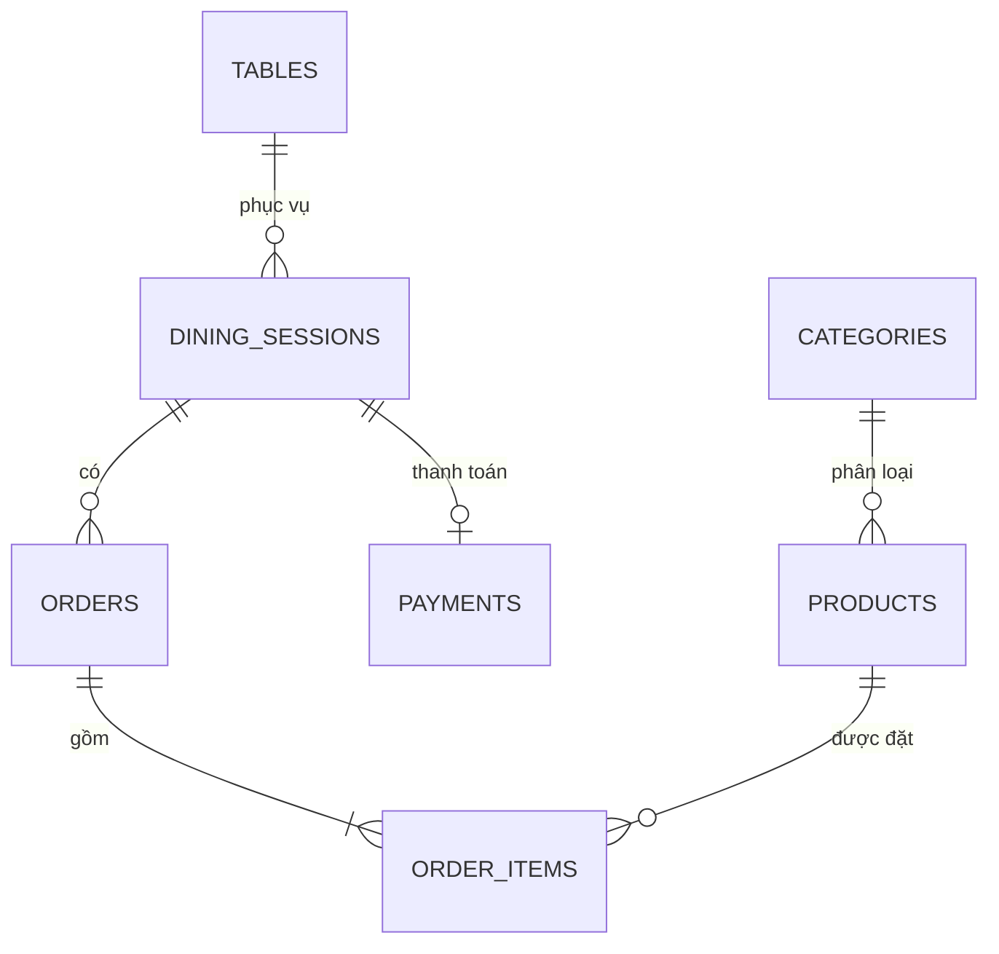

# Cơ sở dữ liệu QRFood

Tài liệu này mô tả cơ sở dữ liệu PostgreSQL của QRFood, cách khởi tạo trên máy local, cấu trúc bảng, quan hệ dữ liệu và cách quản lý migration bằng Flyway.

## 1. Công nghệ và cấu hình mặc định

- Hệ quản trị: PostgreSQL 15 trở lên.
- ORM: Spring Data JPA và Hibernate.
- Migration: Flyway.
- Database mặc định: `qrfood`.
- Host và port local: `localhost:5432`.
- Username/password mặc định: `qrfood` / `qrfood`.

Backend đọc cấu hình từ biến môi trường:

```env
DATABASE_URL=jdbc:postgresql://localhost:5432/qrfood
DATABASE_USERNAME=qrfood
DATABASE_PASSWORD=qrfood
```

Không sử dụng thông tin đăng nhập mặc định khi triển khai production.

## 2. Khởi tạo PostgreSQL local

Mở `psql` bằng tài khoản quản trị PostgreSQL và chạy:

```sql
CREATE USER qrfood WITH PASSWORD 'qrfood';
CREATE DATABASE qrfood OWNER qrfood;
GRANT ALL PRIVILEGES ON DATABASE qrfood TO qrfood;
```

Kiểm tra kết nối:

```powershell
psql -h localhost -p 5432 -U qrfood -d qrfood
```

Khởi động backend:

```powershell
cd C:\Users\Admin\Desktop\QRFood\backend
mvn spring-boot:run
```

Flyway tự động tạo và cập nhật schema khi backend khởi động. Không cần chạy thủ công từng file SQL.

## 3. Các migration

Các file nằm trong `backend/src/main/resources/db/migration`:

| Phiên bản | File | Nội dung |
|---|---|---|
| V1 | `V1__init.sql` | Schema chính, ràng buộc, index, trigger và dữ liệu thực đơn mẫu |
| V2 | `V2__demo_staff_accounts.sql` | Tài khoản nhân viên phục vụ và nhân viên bếp |
| V3 | `V3__payments.sql` | Bảng và ràng buộc thanh toán |

Flyway lưu lịch sử trong `flyway_schema_history`. Không chỉnh sửa migration đã áp dụng; khi đổi schema hãy tạo file mới, ví dụ `V4__add_product_stock.sql`.

## 4. Sơ đồ quan hệ



`users` là bảng tài khoản nội bộ và chưa có khóa ngoại đến các bảng nghiệp vụ.

## 5. Mô tả các bảng

### `users`

Lưu tài khoản quản trị viên, nhân viên phục vụ và nhân viên bếp.

| Cột | Kiểu | Ý nghĩa |
|---|---|---|
| `id` | `BIGSERIAL` | Khóa chính |
| `username` | `VARCHAR(100)` | Tên đăng nhập, không trùng |
| `password` | `VARCHAR(255)` | Mật khẩu; tài khoản tạo từ giao diện dùng BCrypt |
| `full_name` | `VARCHAR(150)` | Họ tên |
| `role` | `VARCHAR(20)` | `ADMIN`, `STAFF`, `KITCHEN` |

### `tables`

| Cột | Kiểu | Ý nghĩa |
|---|---|---|
| `id` | `BIGSERIAL` | Khóa chính |
| `table_number` | `VARCHAR(20)` | Mã bàn, không trùng |
| `capacity` | `INTEGER` | Sức chứa, lớn hơn 0 |
| `status` | `VARCHAR(30)` | `AVAILABLE`, `OCCUPIED`, `CLEANING`, `MAINTENANCE` |
| `created_at`, `updated_at` | `TIMESTAMP` | Thời điểm tạo/cập nhật |

### `dining_sessions`

Đại diện cho một lượt khách sử dụng bàn.

| Cột | Kiểu | Ý nghĩa |
|---|---|---|
| `id` | `BIGSERIAL` | Khóa chính |
| `table_id` | `BIGINT` | Khóa ngoại đến `tables` |
| `number_of_people` | `INTEGER` | Số khách |
| `status` | `VARCHAR(30)` | `ACTIVE`, `WAITING_PAYMENT`, `COMPLETED`, `CANCELLED` |
| `started_at`, `ended_at` | `TIMESTAMP` | Thời điểm bắt đầu/kết thúc |

Mỗi bàn chỉ có tối đa một phiên mở ở trạng thái `ACTIVE` hoặc `WAITING_PAYMENT`.

### `categories`

Lưu danh mục thực đơn như Burger, Pizza, Drink và Dessert.

| Cột | Kiểu | Ý nghĩa |
|---|---|---|
| `id` | `BIGSERIAL` | Khóa chính |
| `name` | `VARCHAR(100)` | Tên danh mục, không trùng |
| `description` | `VARCHAR(255)` | Mô tả |
| `created_at` | `TIMESTAMP` | Thời điểm tạo |

### `products`

| Cột | Kiểu | Ý nghĩa |
|---|---|---|
| `id` | `BIGSERIAL` | Khóa chính |
| `category_id` | `BIGINT` | Khóa ngoại đến `categories` |
| `name` | `VARCHAR(150)` | Tên món |
| `description` | `VARCHAR(500)` | Mô tả món |
| `price` | `NUMERIC(10,2)` | Giá, không âm |
| `image_url` | `VARCHAR(255)` | URL hình ảnh |
| `is_available` | `BOOLEAN` | Món còn bán hay không |

### `orders`

| Cột | Kiểu | Ý nghĩa |
|---|---|---|
| `id` | `BIGSERIAL` | Khóa chính |
| `session_id` | `BIGINT` | Khóa ngoại đến `dining_sessions` |
| `status` | `VARCHAR(30)` | Trạng thái xử lý |
| `total_amount` | `NUMERIC(10,2)` | Tổng tiền đơn |
| `note` | `VARCHAR(500)` | Ghi chú |
| `confirmed_at`, `completed_at` | `TIMESTAMP` | Thời điểm xác nhận/hoàn tất |
| `rejected_reason` | `VARCHAR(255)` | Lý do từ chối |

Luồng trạng thái:

```text
PENDING → CONFIRMED → PREPARING → READY → SERVED → COMPLETED
    └──────────────→ CANCELLED
```

Đơn `CONFIRMED` cũng có thể chuyển sang `CANCELLED`.

### `order_items`

Giá tại thời điểm đặt được lưu riêng để việc đổi giá sản phẩm không làm thay đổi đơn cũ.

| Cột | Kiểu | Ý nghĩa |
|---|---|---|
| `id` | `BIGSERIAL` | Khóa chính |
| `order_id` | `BIGINT` | Khóa ngoại đến `orders` |
| `product_id` | `BIGINT` | Khóa ngoại đến `products` |
| `quantity` | `INTEGER` | Số lượng, lớn hơn 0 |
| `unit_price` | `NUMERIC(10,2)` | Đơn giá tại thời điểm đặt |
| `subtotal` | `NUMERIC(10,2)` | `unit_price × quantity` |
| `note` | `VARCHAR(255)` | Ghi chú món |

### `payments`

| Cột | Kiểu | Ý nghĩa |
|---|---|---|
| `id` | `BIGSERIAL` | Khóa chính |
| `session_id` | `BIGINT` | Khóa ngoại duy nhất đến `dining_sessions` |
| `amount` | `NUMERIC(10,2)` | Tổng tiền thanh toán |
| `method` | `VARCHAR(20)` | `CASH` hoặc `QR` |
| `status` | `VARCHAR(20)` | `PENDING`, `PAID`, `CANCELLED` |
| `reference_code` | `VARCHAR(100)` | Mã giao dịch duy nhất |
| `created_at`, `paid_at` | `TIMESTAMP` | Thời điểm yêu cầu/xác nhận |

Một phiên có tối đa một giao dịch. Phiên và bàn chỉ đóng sau khi nhân viên xác nhận thanh toán.

## 6. Ràng buộc và index quan trọng

- Mã bàn, username, tên danh mục và mã giao dịch không được trùng.
- Sức chứa bàn, số khách và số lượng món phải dương.
- Giá và tổng tiền không được âm; số tiền thanh toán phải lớn hơn 0.
- `subtotal = unit_price × quantity`.
- Trigger kiểm soát luồng trạng thái đơn và tự cập nhật `updated_at`.
- Index hỗ trợ tra cứu bàn, phiên, đơn, sản phẩm và thanh toán theo trạng thái.

## 7. Dữ liệu mẫu

- Bàn: `A01`, `A02`, `A03`, `A04`.
- Danh mục: Burger, Pizza, Drink, Dessert.
- Một số món Burger, Pizza, đồ uống và món tráng miệng.

| Username | Password | Role |
|---|---|---|
| `admin` | `admin123` | `ADMIN` |
| `staff` | `staff123` | `STAFF` |
| `kitchen` | `kitchen123` | `KITCHEN` |

Mật khẩu mẫu dạng văn bản thuần chỉ dành cho local. Tài khoản tạo từ Admin sử dụng BCrypt.

## 8. Truy vấn kiểm tra

```sql
SELECT id, table_number, capacity, status FROM tables ORDER BY id;

SELECT p.id, c.name AS category, p.name, p.price, p.is_available
FROM products p
JOIN categories c ON c.id = p.category_id
ORDER BY c.name, p.name;

SELECT id, session_id, status, total_amount, created_at
FROM orders ORDER BY id DESC;

SELECT id, session_id, amount, method, status, reference_code, paid_at
FROM payments ORDER BY id DESC;

SELECT installed_rank, version, description, success
FROM flyway_schema_history ORDER BY installed_rank;
```

## 9. Sao lưu và phục hồi

```powershell
# Sao lưu
pg_dump -h localhost -p 5432 -U qrfood -d qrfood -F c -f qrfood.backup

# Phục hồi
pg_restore -h localhost -p 5432 -U qrfood -d qrfood --clean --if-exists qrfood.backup
```

## 10. Reset database local

Lệnh sau xóa toàn bộ dữ liệu. Chỉ dùng cho môi trường local:

```sql
DROP SCHEMA public CASCADE;
CREATE SCHEMA public AUTHORIZATION qrfood;
GRANT ALL ON SCHEMA public TO qrfood;
```

Khởi động lại backend để Flyway chạy lại V1, V2 và V3.

## 11. Lỗi thường gặp

### Không kết nối được PostgreSQL

- Kiểm tra dịch vụ PostgreSQL và cổng `5432`.
- Kiểm tra database/user `qrfood` đã tồn tại.
- Kiểm tra ba biến môi trường database.

### Flyway báo checksum mismatch

Migration cũ đã bị sửa sau khi áp dụng. Với database local không cần giữ dữ liệu, reset schema theo mục 10. Với dữ liệu thật, không reset hoặc sửa checksum tùy tiện; hãy tạo migration mới.

### Hibernate báo schema validation failed

Kiểm tra Flyway chạy thành công và bảng `flyway_schema_history`. Backend dùng `ddl-auto: validate`, nên Hibernate không tự tạo hoặc sửa schema.
