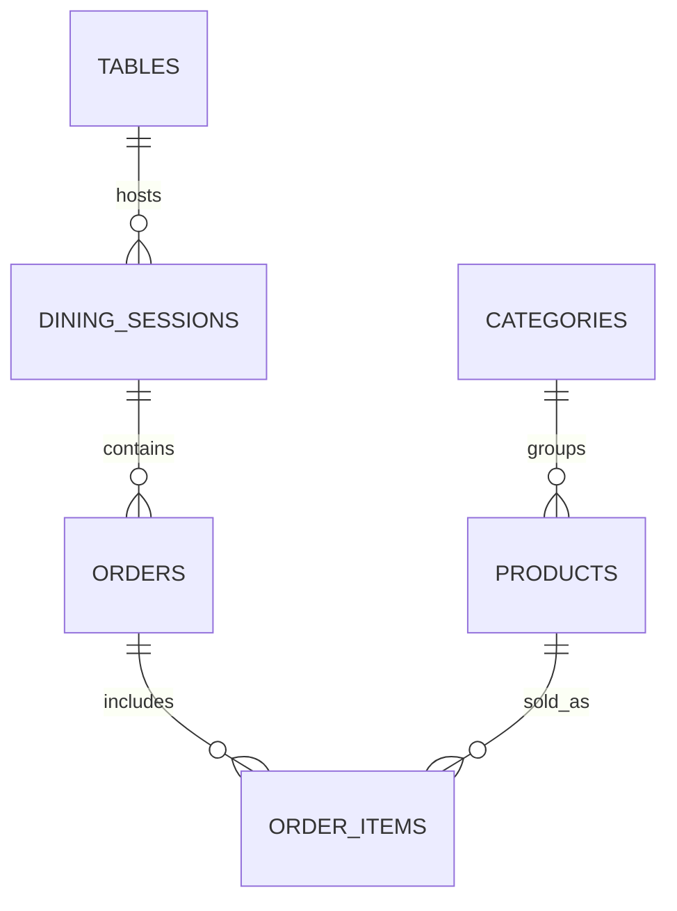

# QRFood Database Design

## Core entities
- users
- tables
- dining_sessions
- categories
- products
- orders
- order_items

## Constraints
- Unique table numbers
- Capacity must be positive
- Each active session references one table
- order item price is stored as numeric

## Example ERD

